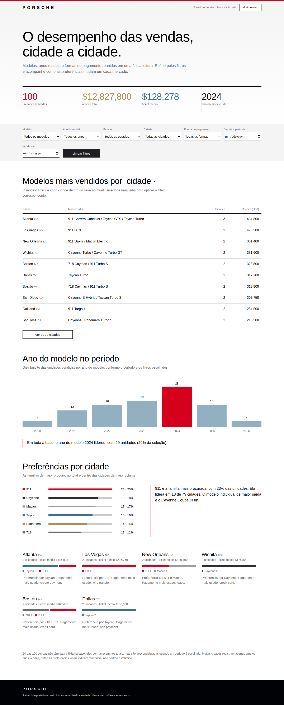
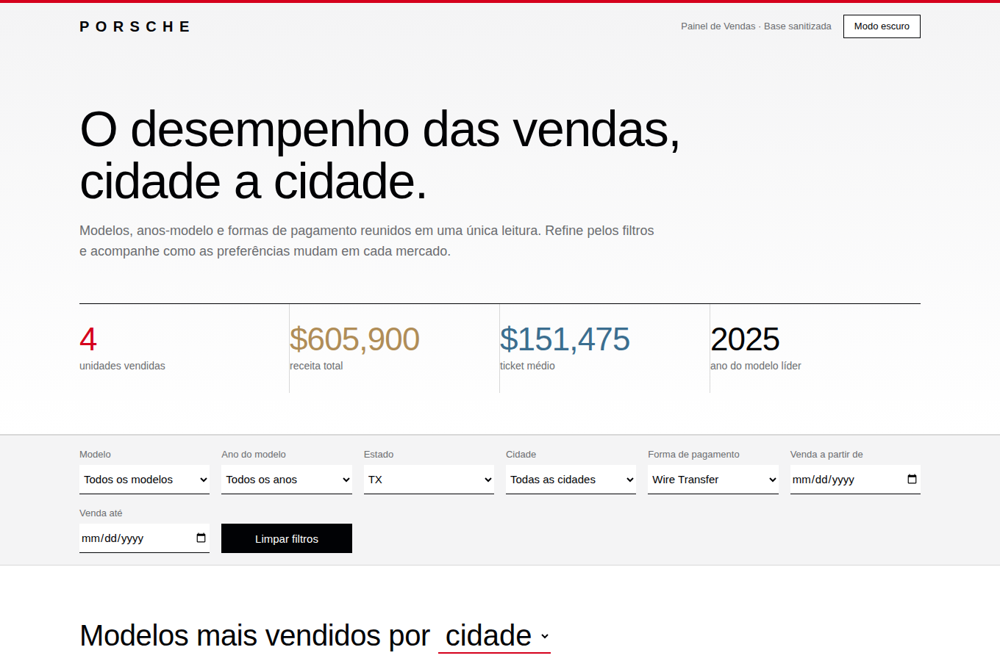
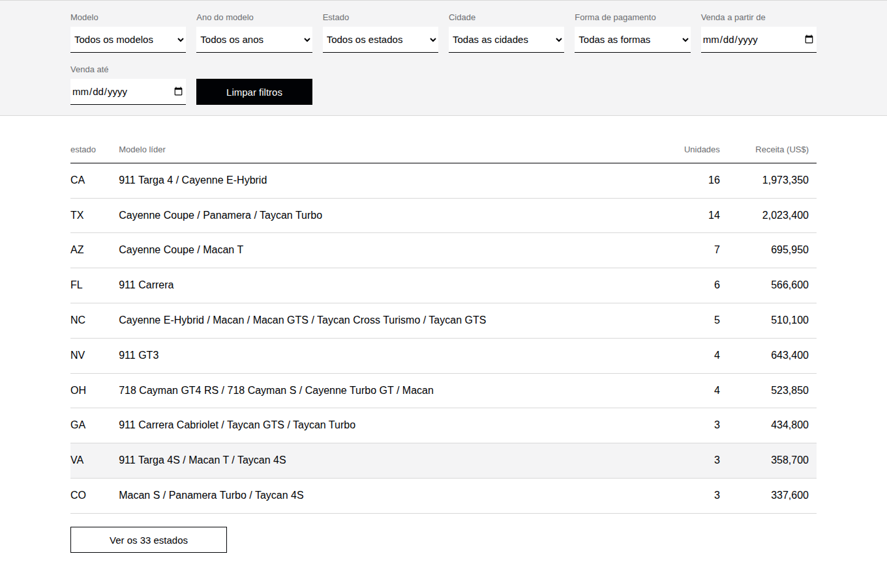

# Porsche | Dashboard de Vendas

Dashboard interativa, em **um único arquivo HTML**, que transforma uma planilha de 100 vendas da Porsche em respostas de negócio. Sem servidor, sem dependências de build: abre direto no navegador e roda no GitHub Pages.

**Dashboard publicada:** https://vldbarbos-oss.github.io/porsche-dashboard-vendas/



## Perguntas de negócio escolhidas e por quê

| # | Pergunta | Como é respondida | Por que importa |
|---|----------|-------------------|-----------------|
| 1 | **Quais os principais modelos vendidos por cidade (ou estado)?** | Tabela com modelo líder, unidades e receita por localidade. Um seletor alterna entre agrupar por cidade e por estado. | Mostra onde cada modelo tem força e orienta estoque e ação comercial regional. |
| 2 | **Qual ano de modelo mais saiu em um período?** | Gráfico de barras por ano do modelo, com o líder em vermelho, mais uma frase-resumo que muda com os filtros e as datas. | Indica qual geração de carro o mercado está absorvendo agora. |
| 3 | **Quais famílias são as mais populares em cada cidade?** | Ranking das famílias (911, 718, Cayenne, Macan, Panamera, Taycan) e cartões das cidades de maior volume, com mistura de famílias, ticket médio e pagamento mais usado. | Transforma o dado em leitura de preferência local. |

Indicadores de topo: unidades vendidas, receita total, ticket médio e ano de modelo líder. Todos respondem aos filtros.

**Filtros:** modelo, ano do modelo, estado, cidade, forma de pagamento e período de venda (de/até).

### Exemplo de filtro aplicado

Estado **TX** + pagamento **Wire Transfer**: 4 unidades, US$ 605.900 de receita e ticket médio de US$ 151.475.



### Agrupando por estado em vez de cidade

Ideia do desafio ("trocar cidade por estado e ver o que muda"): com 79 cidades para 100 vendas, a maioria das cidades tem só 1 ou 2 registros. Agrupar por estado dá amostras maiores e leituras mais estáveis. Por isso o seletor foi mantido na tela.



## Tratamento da base antes de ir para a IA

Feito em `scripts/build_dashboard.py` (reproduzível):

1. Usa a aba `Sanitized` e fica só com as colunas sanitizadas.
2. **Remove `customer_name` e `salesperson`**: como a base vai embutida no HTML público, nenhum dado pessoal entra.
3. Converte preço e ano do modelo para número, em valores puros, sem fórmulas.
4. Datas `INVALID` (24 das 100 vendas) viram vazio. Elas continuam nos totais, mas saem da conta quando um período é escolhido, e a dashboard avisa isso na tela.
5. Normaliza o nome das colunas para português e exporta `data/vendas_sanitizadas.csv`.

O HTML embute só 7 campos por venda: modelo, ano, preço, cidade, estado, pagamento e data.

## O prompt e o que mudou até a versão final

**Prompt inicial** (anexando a planilha):

> Utilizando o recurso de canvas, renderize uma dashboard em HTML.
> Filtros: modelo da Porsche, model year, city, pay method.
> Perguntas de negócio e KPIs: quais os principais modelos vendidos por cidade; qual o ano de modelo que mais saiu em um período; insights de carros populares de vendas com base nos dados em cada cidade.
> UI/UX baseada no site oficial da Porsche Brasil (https://www.porsche.com/brazil/pt/). Manter um ar elegante e refinado.

**Evolução:**

| Versão | O que mudou |
|--------|-------------|
| v1 | Primeira entrega: filtros, três seções, visual em preto e branco inspirado no site da Porsche. Os filtros não populavam. |
| v2 | **Correção de bug:** uma função se chamava `top`, nome reservado do navegador, e derrubava o script inteiro. Renomeada, e os filtros passaram a funcionar. |
| v2 | **Tema:** a página seguia o modo escuro do sistema e as opções dos filtros ficavam ilegíveis. Passou a abrir sempre claro, com botão de modo escuro manual e opções legíveis nos dois temas. |
| v2 | **Paleta:** vermelho Porsche, dourado, azul-aço e grafite, com uma cor por família de modelo. |
| v3 | **Evolução do desafio:** filtro por **estado** e seletor **cidade/estado** na tabela principal. Script de build para regenerar a dashboard com uma base nova. |

Lição prática: depois de cada refinamento, os filtros foram testados em um navegador automatizado (modelo, ano, estado, pagamento, período e limpar filtros) antes de publicar.

## Ferramenta usada

**Claude, com o recurso de artefatos (equivalente ao Canvas)**: o HTML foi gerado e refinado em conversa, com testes automatizados dos filtros. Não foi usado ChatGPT nem agente com skill própria.

## Ideias do desafio: o que foi feito e o que não foi

- Trocar cidade por estado: **feito**.
- Atualizar a dashboard com base nova: **feito**, via `scripts/build_dashboard.py` (`python scripts/build_dashboard.py nova_planilha.xlsx`).
- Outra marca como referência visual ou estilo Power BI: não feito.
- Segunda regra para registros `INVALID`: **não foi possível**, pois a planilha traz só os valores sanitizados, sem o dado cru para reinterpretar.
- Agente com duas skills: não feito.

## Estrutura do repositório

```
├── index.html                    dashboard final (arquivo único, GitHub Pages)
├── src/template.html             template com marcador __DATA__
├── scripts/build_dashboard.py    trata a planilha e gera o index.html
├── data/vendas_sanitizadas.csv   base tratada, sem nomes de pessoas
└── docs/                         prints de tela
```

## Como rodar e publicar

- **Localmente:** abra o `index.html` no navegador.
- **Regenerar:** `pip install pandas openpyxl` e `python scripts/build_dashboard.py caminho/da/planilha.xlsx`.
- **GitHub Pages:** *Settings → Pages → Deploy from a branch → `main` / `(root)`*. O endereço fica `https://SEU-USUARIO.github.io/porsche-dashboard-vendas/`.

## Limites a considerar

- Muitas cidades têm só 1 ou 2 vendas: as preferências locais indicam tendência, não padrão estatístico.
- Valores em dólares, como na planilha.
- A fonte oficial da Porsche (Porsche Next) é proprietária, então a dashboard usa Barlow, de proporções parecidas.
- Projeto de estudo, sem vínculo com a Porsche. A base é sanitizada.
